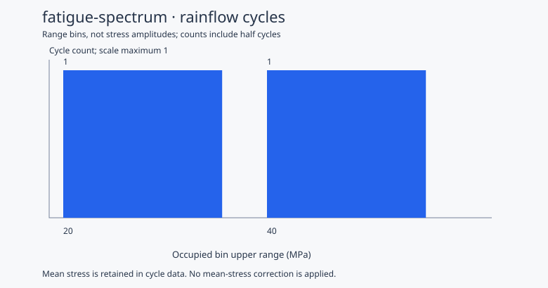

# 机械应力循环谱分析工具

`fatigue-spectrum` 是一个 MoonBit 库和本地命令行工具。从应力记录提取雨流循环，保留幅值、均值、次数及原始位置；输出载荷谱，并根据用户提供的 S–N 曲线计算 Miner 损伤。应力可以来自任何构件或其他分析软件。

## 运行

需要 MoonBit 工具链；native 后端需要本机 C 编译环境。已验证 moon `0.1.20260920 (914d7da)`、moonc `v0.10.14+7d59c7ec9`。运行依赖为 `moonbitlang/async@0.22.4`；计算核心支持 native 和 JS，文件 CLI 使用 native。

在项目目录运行：

```sh
moon run --target native cmd/main -- analyze samples/stress.csv --sn samples/sn.json --bin-width 10 --json _build/analysis.json --cycles _build/cycles.csv --svg _build/spectrum.svg
```

不提供 `--sn` 时只提取循环与直方图。示例产生 3 条循环记录：范围 20 MPa 的一个完整循环，以及范围 40 MPa 的两个半循环。演示曲线下的损伤为 **1.7×10⁻⁵**。[实际结果](samples/analysis.json)与[未分箱循环](samples/cycles.csv)由 CLI 生成。



## 输入与计数约定

应力 CSV 使用未加引号的两列，单位固定为 MPa：

```csv
time_s,stress_mpa
0,0
1,30
2,10
3,40
4,0
```

数值必须有限，时间严格递增；接受 UTF-8 BOM、CRLF 和空行。应力可以为负。原始索引从 0 开始，保留 plateau 结束时的位置，不因转折点筛选重新编号。

计数采用三点雨流方法，残余保留为半循环，不自动假定输入首尾周期闭合。两点非恒值输入产生一个半循环；恒值输入不产生零幅循环。应力历史的采样质量由数据提供者负责，计数工具不恢复缺失的载荷峰值。

输出 `range_mpa` 为峰谷差，S–N 使用的应力幅为其一半。直方图使用稀疏的 `(lower, upper]` 范围区间，第一箱包含零；SVG 的横轴列出实际占用的箱上界。分箱仅用于展示，损伤始终基于原始循环。

S–N JSON 是点数组：

```json
[
  {"amplitude_mpa": 1, "cycles_to_failure": 10000000000},
  {"amplitude_mpa": 10, "cycles_to_failure": 1000000},
  {"amplitude_mpa": 100, "cycles_to_failure": 100}
]
```

至少两个点，幅值与寿命均有限且为正；幅值严格上升、寿命严格下降。区间内进行双对数插值，以 `Σ(count / allowable_cycles)` 计算 Miner 损伤。不外推、不假定曲线外存在疲劳极限。

首版不进行平均应力修正，输出保留 `mean_mpa` 和 `mean_stress_model: "none"`。使用者需确定曲线与所分析应力条件是否适配。示例曲线是 `N = 10¹⁰ / amplitude⁴` 的合成数据，不能用于真实材料寿命结论。

曲线未覆盖某些非零幅值时，JSON 省略 `total_damage`，列出 `out_of_range_cycles`；`evaluated_damage` 仅代表已覆盖的子集。CLI 返回 1，循环 CSV 和谱图仍可使用。恒值输入产生零损伤，但不代表静强度合格。

CLI 返回码：0 为所请求计算完成，1 为 S–N 覆盖不足，2 为无效输入、数值或文件错误。输出不能覆盖输入或彼此重合；路径检查后清除已存在的指定输出，避免失败后残留旧结果。JSON 中的无值可选字段省略。

## 调用计算核心

在调用方 `moon.pkg` 中导入 `"gckbbrant/fatigue-spectrum" @fatigue`。公开类型与接口见 [pkg.generated.mbti](pkg.generated.mbti)。

- `extract_cycles(stress)` 返回未分箱循环或结构化错误。
- `build_spectrum(cycles, width)` 生成显示用的范围直方图。
- `calculate_damage(cycles, curve)` 返回逐循环损伤与曲线覆盖情况。
- `parse_stress_csv`、`cycles_csv` 与 `render_spectrum_svg` 提供文件和图表接口。

完整独立示例：[examples/basic/main.mbt](examples/basic/main.mbt)。

```sh
moon run --target native examples/basic
moon run --target js examples/basic
```

本地消费时将本项目和调用方列入 `moon.work`，调用方 `moon.mod` 引入 `gckbbrant/fatigue-spectrum@0.1.0`，再在包中导入核心。该库不依赖 bolt-preload；配套使用只需读取其导出的 `time_s,stress_mpa` CSV。

## 测试与对照

```sh
moon check --target native
moon test --target native
moon test --target js
python tests/test_cli.py
```

雨流参考对照需要可选的 Python 依赖：

```sh
python -m pip install rainflow==3.2.0
python scripts/compare_rainflow.py --cases 500 --seed 20261013
```

对照包含 12 组固定序列及 500 组随机序列，共比较 13377 条循环记录，范围、均值、次数和原始位置均无差异。[对照结果](samples/reference-check.json)记录版本、随机种子、命令和容差。

参考 rainflow 3.2.0 的两点输入会遗漏末端，恒值序列会产生零范围半循环；比较脚本明确应用本项目的端点约定后逐项比较，保留原始参考程序。核心测试另以手算验证这些约定、半循环残余、曲线端点、紧邻幅值与大寿命比的插值精度。

算法参考：[rainflow 3.2.0](https://github.com/iamlikeme/rainflow)。项目采用 [Apache-2.0](LICENSE)，参考实现的 MIT 许可全文保存在 [NOTICE](NOTICE)。Python 仅用于测试，运行库与 CLI 不依赖 Python。
